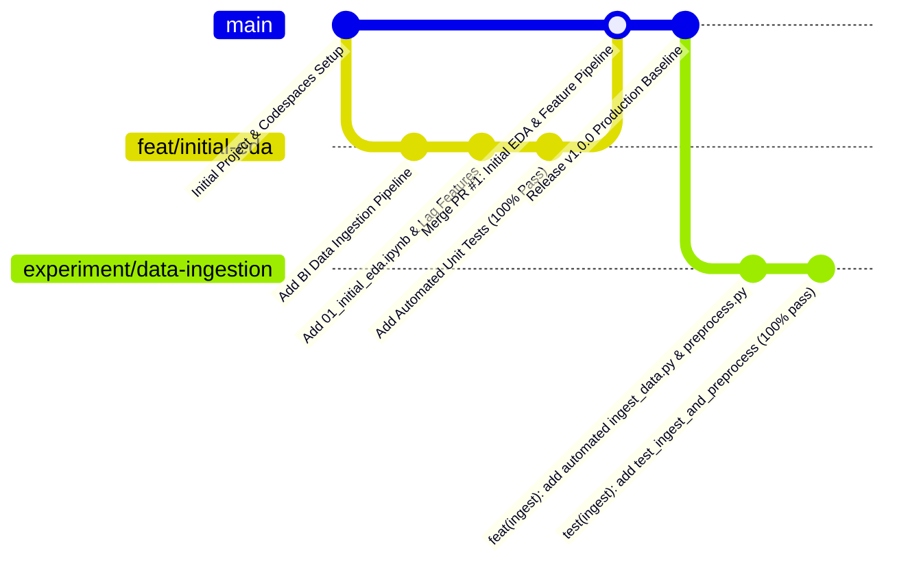

# 📈 MLOps-USD-IDR-Exchange-Rate-Prediction
### Sistem Prediksi Kurs USD/IDR Berbasis Machine Learning dengan Strategi Continual Learning dan Monitoring MLOps

[](https://codespaces.new/TOBIANDA/MLOps-USD-IDR-Exchange-Rate-Prediction)


---

## 📌 1. Deskripsi Proyek
Repositori ini berisi fondasi teknis dan implementasi pipeline **Machine Learning Operations (MLOps)** untuk peramalan deret waktu (*time-series forecasting*) nilai tukar mata uang **USD/IDR** menggunakan data resmi **Bank Indonesia Web Service**.

Proyek ini dibangun untuk memenuhi penugasan **Lembar Kerja 02 (LK-02)** pada mata kuliah **MLOps TIF-B 2026**, Fakultas Ilmu Komputer, Universitas Brawijaya.

### 👤 Identitas Pengembang
- **Nama**: Tobias Andra Valentino
- **NIM**: 245150200111076
- **Kelas**: MLOps TIF-B 2026
- **Dosen Pengampu**: Rizal Setya Perdana, S.Kom., M.Kom., Ph.D. (Email Kolaborator: `rizalespe@gmail.com`)

---

## 🚀 2. Panduan 1-Klik GitHub Codespaces (Reproducible Environment)

Proyek ini telah dikonfigurasi secara lengkap menggunakan **GitHub Codespaces** (`.devcontainer/devcontainer.json`). Lingkungan komputasi awan ini memastikan bahwa seluruh dependensi, ekstensi VS Code, dan konfigurasi port terinstalasi otomatis secara instan tanpa galat ketergantungan (*dependency error*).

### Cara Menjalankan di Codespaces:
1. Klik tombol **Open in GitHub Codespaces** di atas, atau klik tombol hijau **Code** > **Codespaces** > **Create codespace on main**.
2. Lingkungan virtual berbasis kontainer Debian Linux dengan **Python 3.11** akan otomatis terbangun.
3. Seluruh dependensi pada `requirements.txt` akan diinstalasi otomatis melalui skrip `postCreateCommand`.
4. Port `8000` (FastAPI REST API) dan `8888` (Jupyter Lab) secara otomatis di-forward.

---

## 📂 3. Struktur Direktori (Standar Cookiecutter Data Science)

Struktur repositori ini mengikuti konvensi industri Data Science dan MLOps terbaik:

```text
MLOps-USD-IDR-Exchange-Rate-Prediction/
├── .devcontainer/                  # Konfigurasi standardisasi GitHub Codespaces
│   └── devcontainer.json           # Definisi container Python 3.11 & ekstensi VS Code
├── config/                         # Konfigurasi parameter pipeline & model
│   └── config.yaml                 # Hyperparameters, paths, dan settings
├── data/                           # Data storage terstruktur
│   ├── raw/                        # Data mentah kurs BI (CSV/JSON/timestamped snapshots)
│   │   ├── usd_idr_raw.csv         # Pointer kanonikal dataset mentah terkini
│   │   ├── usd_idr_raw_latest.csv  # Alias rilis data mentah terbaru
│   │   ├── usd_idr_raw_*.csv       # Snapshot berkala non-destruktif ber-timestamp
│   │   └── ingestion_manifest_*.json # Manifest metadata tiap eksekusi penarikan
│   ├── processed/                  # Data bersih & fitur siap latih
│   │   ├── usd_idr_cleaned.csv     # Hasil prapemrosesan & validasi sanitasi perbankan
│   │   ├── usd_idr_featured.csv    # Matriks fitur hasil feature engineering (26 fitur)
│   │   └── preprocessing_report.json # Laporan audit pembersihan & missing values
│   └── exchange_rates.db           # SQLite database telemetri historis kurs (idempotent cache)
├── docs/                           # Dokumentasi teknis dan arsitektur
│   ├── architecture.md             # Diagram alur sistem dan modul MLOps
│   └── data_architecture_diagram.png # Diagram arsitektur pipeline data resolusi tinggi
├── models/                         # Model registry dan serialisasi artefak
│   ├── model_champion.pkl          # Model Ridge Regression terlatih
│   └── model_metadata.json         # Metadata performa & benchmark hurdle
├── notebooks/                      # Eksplorasi interaktif & eksperimen awal
│   └── 01_initial_eda.ipynb        # Analisis EDA, autokorelasi, & Random Walk baseline
├── src/                            # Source code modular produksi
│   ├── __init__.py
│   ├── ingest_data.py              # [LK-04] Skrip pengumpul data dinamis otomatis (Bank Indonesia)
│   ├── preprocess.py               # [LK-04] Skrip prapemrosesan & sanitasi domain finansial
│   ├── data/                       # Package abstraksi modul data & kompatibilitas Codespaces
│   │   ├── __init__.py
│   │   ├── ingest_data.py          # Proxy modular penarikan data
│   │   └── preprocess.py           # Proxy modular prapemrosesan
│   ├── ingestion/                  # Core engine penarikan Bank Indonesia & ETL
│   │   ├── __init__.py
│   │   ├── fetcher.py              # Worker HTTP SOAP/XML Bank Indonesia
│   │   └── etl_pipeline.py         # Full DAG ETL pipeline
│   ├── features/                   # Pipeline rekayasa fitur (lags & rolling statistics)
│   │   ├── __init__.py
│   │   └── pipeline.py
│   ├── models/                     # Modul pelatihan, validasi, dan benchmarking
│   │   ├── __init__.py
│   │   └── trainer.py
│   └── api/                        # REST API serving microservice (FastAPI)
│       ├── __init__.py
│       └── app.py
├── tests/                          # Pengujian otomatis (Unit Testing via Pytest)
│   ├── __init__.py
│   ├── test_ingest_and_preprocess.py # [LK-04] Unit test ingestion non-destruktif & prapemrosesan
│   ├── test_etl.py                 # Validasi DAG ETL pipeline
│   ├── test_ingestion.py           # Validasi integritas database SQLite
│   ├── test_features.py            # Validasi zero lookahead bias pada fitur
│   ├── test_models.py              # Validasi serialisasi dan performa model
│   └── test_api.py                 # Validasi endpoint REST API
├── dvc.yaml                        # Spesifikasi DAG pipeline DVC
├── .dvcignore                      # Aturan pengecualian DVC
├── .gitignore                      # Python .gitignore standar
├── LICENSE                         # Lisensi Open-Source MIT
├── README.md                       # Dokumentasi utama proyek
└── requirements.txt                # Daftar dependensi produksi & pengujian
```

---

## 🌿 4. Strategi Pengelolaan Kode (GitHub Flow)

Proyek ini menerapkan alur kerja **GitHub Flow** secara disiplin:



1. **Branch `main`**: Branch utama yang selalu siap rilis (*production-ready*) dan terproteksi.
2. **Branch Fitur (`feat/initial-eda`)**: Branch pengerjaan awal untuk analisis eksplorasi data dan baseline pipeline.
3. **Branch Eksperimen (`experiment/data-ingestion`)**: Branch khusus untuk implementasi skrip pengumpul data dinamis (`ingest_data.py`), simulasi periodik non-destruktif, dan automasi prapemrosesan (`preprocess.py`).

---

## 🔄 5. Panduan Pengumpulan Data Dinamis & Prapemrosesan (Continual Learning)

Sistem ini didesain untuk mendukung paradigma **Continual Learning**, di mana model Machine Learning dapat diperbarui secara berkala seiring masuknya data pasar valas harian terbaru tanpa merusak riwayat masa lalu.

### A. Penarikan Data Dinamis Otomatis (`src/ingest_data.py`)
Skrip `src/ingest_data.py` mengambil data kurs transaksi resmi dari endpoint SOAP/XML Bank Indonesia (`getSubKursLokal3`) menggunakan library `requests`.

#### Fitur Utama Ingestion:
1. **Simulasi Periodik Non-Destruktif**:
   Setiap kali skrip dijalankan, data disimpan dengan penamaan berbasis cap waktu (*timestamp*), contoh: `data/raw/usd_idr_raw_20260928_162155.csv`. Data historis lama **tidak akan pernah tertimpa atau hilang secara destruktif**.
2. **Kanonikal & Latest Pointer**:
   Selain file bertanda waktu, skrip otomatis memperbarui `usd_idr_raw_latest.csv` dan `usd_idr_raw.csv` agar pipeline hilir selalu mendapatkan dataset termutakhir secara konsisten.
3. **Sinkronisasi Idempoten ke SQLite**:
   Data yang ditarik otomatis disinkronkan ke `data/exchange_rates.db` menggunakan klausul `INSERT OR IGNORE`. Jika skrip dijalankan 100 kali sehari sekalipun, basis data lokal dijamin bebas dari duplikasi baris.
4. **Dukungan Multi-Format**:
   Mendukung ekspor langsung dalam format **CSV** maupun **JSON**.

#### Cara Menjalankan Skrip Ingestion:
```bash
# 1. Penarikan default (30 hari bursa terakhir, format CSV)
python src/ingest_data.py

# 2. Penarikan kustom rentang hari lebih panjang (misal 180 hari)
python src/ingest_data.py --days 180

# 3. Penarikan multi-format (menghasilkan CSV dan JSON sekaligus)
python src/ingest_data.py --days 30 --format all

# 4. Alternatif eksekusi melalui folder src/data
python src/data/ingest_data.py --days 30
```

---

### B. Automasi Prapemrosesan Data (`src/preprocess.py`)
Skrip `src/preprocess.py` bertugas menginspeksi, memvalidasi kualitas, dan membersihkan data mentah dari `data/raw/` sebelum dimasukkan ke dalam tahap ekstraksi fitur.

#### Tahapan Prapemrosesan yang Diterapkan:
1. **Pemeriksaan & Penanganan Nilai Kosong (*Missing Values*)**:
   Mendeteksi nilai `NaN` atau `Null` pada seluruh atribut finansial dan menghapus baris yang tidak lengkap secara deterministik.
2. **Pembersihan & Standardisasi Tipe Data**:
   Mengonversi `beli`, `jual`, `tengah`, dan `spread` ke numerik desimal murni (`float64`) serta menghapus pemisah ribuan koma/spasi.
3. **Pengurutan Kronologis & Deduplikasi**:
   Menyeragamkan format tanggal ke standar ISO `YYYY-MM-DD`, membuang tanggal ganda (`drop_duplicates`), dan mengurutkan baris secara strictly ascending (masa lalu $\rightarrow$ masa kini).
4. **Validasi Aturan Sanitasi Finansial (*Domain Sanity Checks*)**:
   - Nilai kurs wajib bernilai positif: $\text{beli} > 0$ dan $\text{jual} > 0$.
   - Harga jual pasar valas wajib lebih tinggi atau sama dengan harga beli: $\text{beli} \le \text{jual}$.
   - Kurs tengah dihitung ulang secara presisi: $\text{tengah} = \frac{\text{beli} + \text{jual}}{2}$.
   - Selisih spread wajib positif: $\text{spread} = \text{jual} - \text{beli} > 0$.
5. **Generasi Laporan Audit Integritas Data**:
   Menyimpan metrik ringkasan (jumlah baris awal vs akhir, volatilitas return harian, rentang tanggal) ke `data/processed/preprocessing_report.json`.

#### Cara Menjalankan Skrip Prapemrosesan:
```bash
# 1. Prapemrosesan otomatis (otomatis mendeteksi file raw terbaru di data/raw/)
python src/preprocess.py

# 2. Prapemrosesan file raw tertentu
python src/preprocess.py --input data/raw/usd_idr_raw_latest.csv --output-file usd_idr_cleaned.csv

# 3. Alternatif eksekusi melalui folder src/data
python src/data/preprocess.py
```

---

## 💻 6. Panduan Menjalankan Proyek Secara Lengkap

### 1. Kloning Repositori
```bash
git clone https://github.com/TOBIANDA/MLOps-USD-IDR-Exchange-Rate-Prediction.git
cd MLOps-USD-IDR-Exchange-Rate-Prediction
```

### 2. Buat Virtual Environment & Install Dependensi
```bash
python -m venv .venv
# Aktifkan environment (Windows)
.venv\Scripts\activate
# Aktifkan environment (Linux/macOS)
source .venv/bin/activate

pip install --upgrade pip
pip install -r requirements.txt
```

### 3. Eksekusi Pipeline Pengumpulan & Prapemrosesan Data
```bash
# Tarik data dinamis terbaru dari Bank Indonesia
python src/ingest_data.py --days 30 --format all

# Bersihkan dan validasi data mentah
python src/preprocess.py
```

### 4. Jalankan Pengujian Otomatis (Unit Testing 100% Pass)
```bash
python -m pytest tests/ -v
```

### 5. Pelatihan Model & Evaluasi Benchmark
```bash
python -m src.models.trainer
```

### 6. Jalankan FastAPI Serving Server
```bash
python -m uvicorn src.api.app:app --host 0.0.0.0 --port 8000 --reload
```
Akses dokumentasi interaktif Swagger UI di browser: `http://127.0.0.1:8000/docs`.

---

## 📊 7. Metrik Evaluasi & Benchmark Random Walk

Sesuai *Efficient Market Hypothesis* (EMH), model Machine Learning wajib dievaluasi terhadap standar industri finansial:
- **Baseline 1 (Naive Random Walk)**: $y_{t+1} = y_t$
- **Baseline 2 (Rolling 7-Day Moving Average)**: $y_{t+1} = \frac{1}{7} \sum_{i=0}^6 y_{t-i}$
- **Candidate ML Model**: Ridge Regression dengan L2 regularization dan fitur momentum autoregresif.

---

## ✉️ 8. Undangan Kolaborator Dosen
Untuk transparansi monitoring berkala:
1. Masuk ke tab **Settings** repositori GitHub.
2. Pilih menu **Collaborators** > **Add people**.
3. Masukkan email dosen pengampu: `rizalespe@gmail.com` dan kirim undangan kolaborasi.

